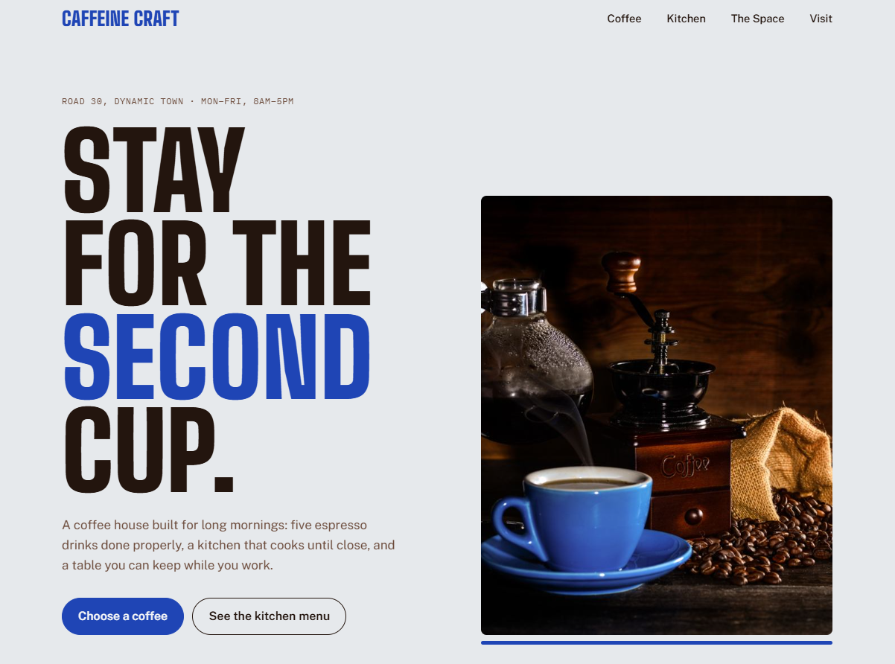
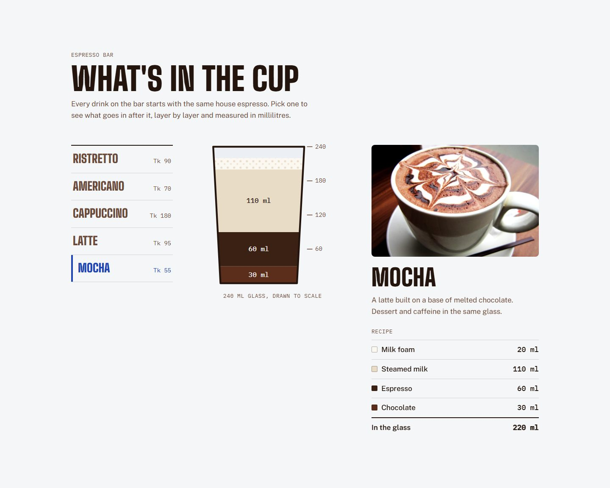
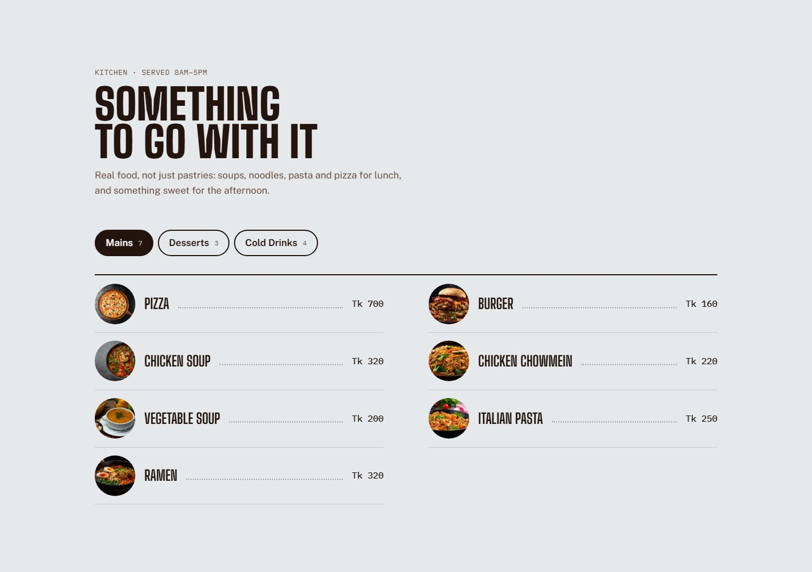
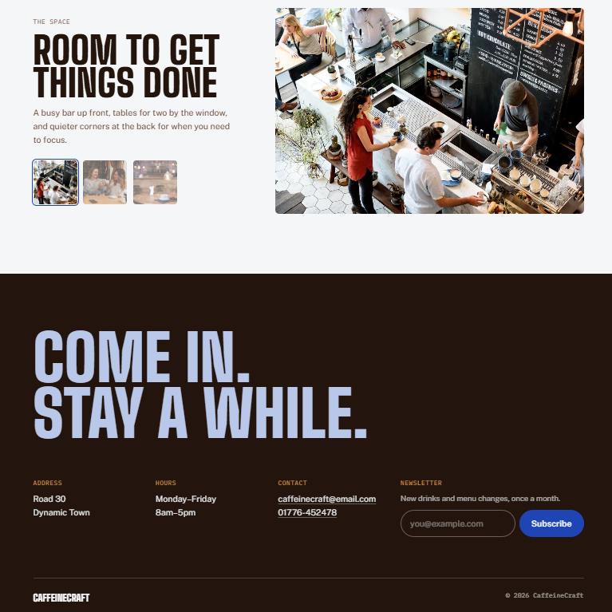
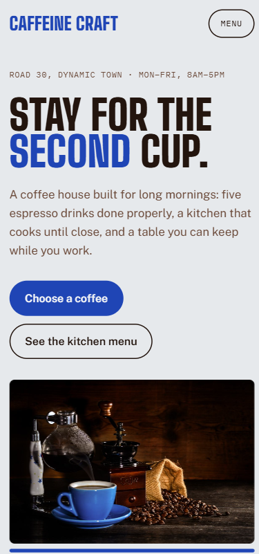

# ☕ CaffeineCraft

CaffeineCraft is a responsive website for a neighbourhood coffee house, built with **React**. It introduces the café's espresso drinks, kitchen menu and space, and tells visitors where and when to find it.

The standout feature is **"What's in the cup"**: pick a drink and a to-scale 240 ml glass fills layer by layer, showing exactly how much espresso, milk, foam, water or chocolate goes into it.

## Live Demo
 [View the Live Site](https://caffeine-craft.netlify.app/)

## Screenshots

### Hero


### What's in the cup


### Kitchen menu


### The space and visit info


### Mobile


## Features

- **Header:** a sticky navigation bar that turns solid when you scroll. On phones it collapses into a Menu button, which you can close with <kbd>Esc</kbd>.
- **Hero:** the café's address and opening hours, a headline, and two buttons that jump to the coffee and the kitchen menu.
- **What's in the cup:** five espresso drinks. Choosing one plays an animated "pour" into an SVG glass drawn to scale, alongside a photo, a short description and a recipe table in millilitres.
- **Kitchen menu:** mains, desserts and cold drinks loaded from JSON, laid out like a printed menu with dotted leaders and prices in Taka.
- **The space:** a photo gallery of the café with thumbnail buttons.
- **Visit:** address, hours, clickable email and phone links, and a newsletter sign-up form.
- **Shareable state:** the selected coffee and menu tab are saved in the URL, for example `?coffee=mocha&menu=desserts`, so a link opens the same view.

## Tech Stack

- **Frontend:** React, JavaScript
- **Build tool:** Create React App (`react-scripts` 5)
- **Styling:** plain CSS with custom properties, one stylesheet per component
- **Testing:** Jest and React Testing Library

## Getting Started

```bash
git clone <this-repo-url>
cd caffeine-craft
npm install
npm start
```

## Project Structure

```
src/
├── App.js / App.css        Page layout, colour and font variables, shared styles
├── utils.js                Price formatting, URL-state hook, image preloading, tab keyboard handling
├── json/data.json          Coffees (with recipes), kitchen menu and gallery photos
└── components/
    ├── Header/             Sticky navigation
    ├── StarSection/        Hero
    ├── UniqueCategory/     "What's in the cup" coffee picker and glass
    ├── Items/              Kitchen menu
    ├── Place/              Café photo gallery
    └── Footer/             Visit info and newsletter
```
